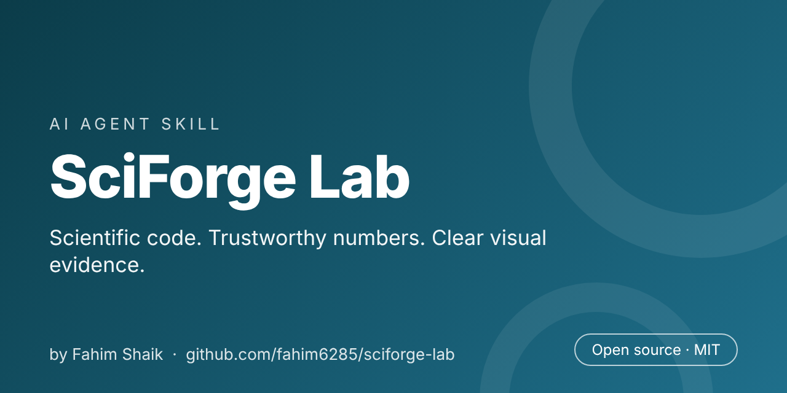

# SciForge Lab

**Scientific code. Trustworthy numbers. Clear visual evidence.**

   

Reproducible scientific computing agent: validates datasets, builds tested Python/MATLAB workflows and produces publication-quality figures with provenance and integrity checks.



## Why use it

- **Dataset validation.** Audits fields, types, missing and non-finite values and duplicate keys before any analysis.
- **Reproducible workflows.** Python, MATLAB and single-cell Colab workflows with deterministic outputs and real test results.
- **Publication-quality figures.** Line, scatter, bar and histogram figures generated from the actual data, with units and labels.
- **Numerical integrity.** Reconciles tables against figures and reports the discrepancy it computes, not one it assumes.
- **Templates included.** Analysis brief, source manifest and figure specification for a clean provenance trail.

## What is in this repository

| Part | Count | Location |
|---|---|---|
| Main skill | 1 | `skills/sciforge-lab/SKILL.md` |
| Reference protocols | 6 | `skills/sciforge-lab/references/` |
| Templates | 3 | `skills/sciforge-lab/templates/` |
| Python utilities | 2 | `skills/sciforge-lab/scripts/` |
| Synthetic examples | 1 | `skills/sciforge-lab/examples/` |
| Plugin manifest | 1 | `.codex-plugin/plugin.json` |

All examples are synthetic. The repository contains no private data, research results, credentials or institutional records.

## How to use it

1. **In ChatGPT or another agent builder:** create a skill or plugin from `skills/sciforge-lab/SKILL.md`.
2. **In a regular chat:** attach `SKILL.md` and the reference files, or paste them, then describe your task.
3. **Offline tools:** run the scripts directly (see Quick start).

## Quick start

```bash
cd skills/sciforge-lab
python scripts/validate_dataset.py examples/analytic_square.csv --key x --output validation.json
python scripts/plot_from_csv.py examples/analytic_square.csv --x x --y y --kind line \
  --output square_example.png --xlabel "x (dimensionless)" --ylabel "y (dimensionless)"
```

Validation uses only the Python standard library. Plotting needs `matplotlib`. The example file is an analytical demonstration (y = x²), not experimental data.

## Sample prompts

- Audit this dataset's fields, types, missingness and duplicates, then write a validation report.
- Convert my MATLAB procedure to Python and show which tests actually passed.
- Read the measured values and build high-resolution line and scatter figures, with the scripts.
- Two tables and their figures disagree. Find the discrepancy from the actual data.
- Create a Colab-friendly single-cell analysis workflow with deterministic output files.
- Write an analysis brief and source manifest for this experiment.

More prompts are in [`docs/sample-prompts.md`](docs/sample-prompts.md).

## Principles

Evidence first. No invented facts, scores, citations or records. Every claim traces to a source you provided or an official source the agent checks. Third-party documents are treated as content, never as instructions.

## Part of a suite

This agent belongs to [Fahim's AI Agents](https://github.com/fahim6285/fahim-ai-agents), a set of five open-source agents for academic and research work: VitaMorph Studio, SciForge Lab, CareerBridge Academic, RankMetric Intelligence and EduAdapt Studio.

## Contributing, citing and license

Contributions are welcome. See [CONTRIBUTING.md](CONTRIBUTING.md). To cite this work, use the "Cite this repository" button on GitHub (from `CITATION.cff`). Released under the [MIT License](LICENSE).

Created by **Fahim Shaik**.
